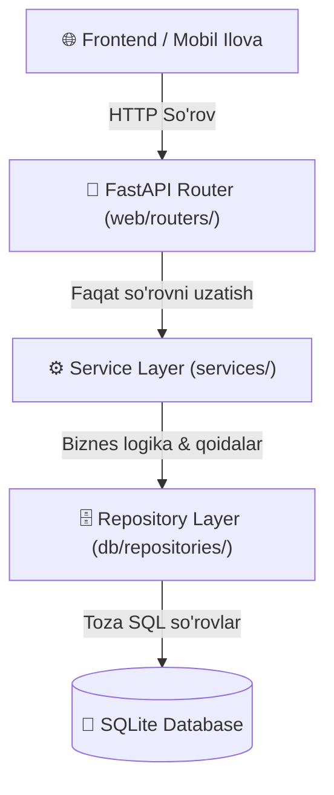

# 🏗️ Web Routers Clean Architecture Refactoring Rejasi

## [Goal Description]
Loyiha tahlil qilinganda `web/routers/` papkasidagi fayllarda **Separation of Concerns** (Javobgarlikni ajratish) tamoyili buzilganligi aniqlandi. Routerlar faqat HTTP so'rovlarni qabul qilib, javob qaytarishi kerak bo'lgan joyda:
1. Xom SQL so'rovlarni to'g'ridan-to'g'ri `conn.execute()` orqali bajarmoqda (`cabinet.py`, `chat.py`, `admin_analytics.py`, `users.py`, `player.py`).
2. Biznes logikalarni (kabinet va xona yaratish, xabar yuborish, ma'lumotlarni hisoblash) to'g'ridan-to'g'ri endpoint ichida amalga oshirmoqda.
3. 14 tagacha turli repozitoriylarni bitta routerda aralashtirib ishlatmoqda (`player.py`).

**Maqsad:** Routerlardagi barcha xom SQL so'rovlarni tegishli **Repository** klasslariga, biznes logikalarni esa **Service** klasslariga ko'chirish. Routerlarni faqat so'rov qabul qiluvchi va servis chaqiruvchi ixcham (har bir endpoint 3–5 qator) holatga keltirish.

---

## 🏛️ Maqsadli Arxitektura Sxemasi



---

## User Review Required

> [!IMPORTANT]
> Har bir bosqich API shartnomasini (Request & Response JSON formatlarini) **100% o'zgarishsiz** saqlaydi. Frontend yoki Telegram bot tomonida hech qanday sinish yoki uzilish bo'lmaydi.

> [!NOTE]
> Refactoring 5 ta alohida va xavfsiz bosqichda amalga oshiriladi:
> 1. `cabinet.py` -> `CabinetRepository` & `CabinetService`
> 2. `chat.py` -> `ChatRepository` & `MessagingService`
> 3. `admin_analytics.py` -> `AnalyticsService` & `AdminRepository`
> 4. `users.py` -> `UserRepository` & `MentorApplicationRepository`
> 5. `player.py` -> `LessonRepository`

---

## Open Questions

> [!NOTE]
> Barcha o'zgarishlarni bitta katta qadamda bajaramizmi yoki har bir bosqichni alohida (masalan, avval `cabinet.py` ni qilib, tekshirib, keyin keyingisiga o'tib) sinab ko'ramizmi? *(Tavsiya: Birin-ketin bosqichma-bosqich bajarish eng xavfsizi).*

---

## Proposed Changes

---

### 1. Cabinet Komponenti (`cabinet.py`)

#### Muammo:
`cabinet.py` ichida `SELECT`, `INSERT`, `UPDATE`, `DELETE` xom SQL so'rovlari va kabinet/xona yaratish logikasi mavjud.

#### [MODIFY] [cabinet_repo.py](file:///C:/Users/Acer/Downloads/BilimGo_TOLIQ/BilimGo/db/repositories/cabinet_repo.py)
* `get_cabinets_for_user(user_id: int, is_admin: bool) -> list[dict]`: Foydalanuvchining a'zolikdagi barcha kabinetlarini talabalar soni bilan qaytaruvchi SQL so'rovni repozitoriyga kiritish.
* `get_cabinet_branding(cabinet_id: int) -> dict`: Kabinetning joriy brending sozlamalarini olish.
* `update_cabinet(cabinet_id: int, display_name: str, branding_config: str) -> None`: Kabinetni yangilash.
* `delete_cabinet_cascade(cabinet_id: int) -> None`: Kabinet, uning a'zolari, chat xonalari va xabarlarini bitta atomik tranzaksiyada o'chirish.

#### [MODIFY] [cabinet_service.py](file:///C:/Users/Acer/Downloads/BilimGo_TOLIQ/BilimGo/services/cabinet_service.py)
* `create_cabinet(...)`: Litsenziya tugunini topish, kabinet yaratish, mentorni qo'shish, boshlang'ich xonani yaratish va agar berilgan bo'lsa boshlang'ich xabarni yozish biznes logikasini to'liq servisga o'tkazish.
* `get_user_cabinets(user_id: int, is_admin: bool)`: Kabinetlar ro'yxatini formatlash.
* `update_cabinet_details(...)`: Brending parametrlarini yangilash.

#### [MODIFY] [cabinet.py](file:///C:/Users/Acer/Downloads/BilimGo_TOLIQ/BilimGo/web/routers/cabinet.py)
* `conn = database.conn` va barcha `cursor = await conn.execute(...)` qatorlarini olib tashlash.
* Faqat `CabinetService.create_default()` orqali chaqiruvlarni qoldirish.

---

### 2. Chat Komponenti (`chat.py`)

#### Muammo:
`_resolve_room_id` funksiyasida xom SQL orqali xona qidirish, yaratish va a'zolikka qo'shish logikasi routerda joylashgan. `poll_messages` da xom SQL yozilgan.

#### [MODIFY] [chat_repo.py](file:///C:/Users/Acer/Downloads/BilimGo_TOLIQ/BilimGo/db/repositories/chat_repo.py)
* `resolve_or_create_room(clean_num: int, user_id: int) -> int`: Xona mavjudligini tekshirish, yo'q bo'lsa yaratish va foydalanuvchini a'zo qilish.
* `get_messages_after(room_id: int, after_id: int, limit: int = 100) -> list[dict]`: Yangi xabarlarni foydalanuvchi ma'lumotlari bilan olish.

#### [MODIFY] [messaging_service.py](file:///C:/Users/Acer/Downloads/BilimGo_TOLIQ/BilimGo/services/messaging_service.py)
* Xona aniqlash va xabarlarni olish logikasini integratsiya qilish.

#### [MODIFY] [chat.py](file:///C:/Users/Acer/Downloads/BilimGo_TOLIQ/BilimGo/web/routers/chat.py)
* Barcha xom SQL va `conn` ob'ektlarini olib tashlash, toza servis chaqiruviga o'tkazish.

---

### 3. Analytics Komponenti (`admin_analytics.py`)

#### Muammo:
`get_platform_admin_overview` ichida ketma-ket 6 ta xom `SELECT COUNT(*)` va `get_cabinet_students_activity` ichida 50 qatorli murakkab multi-table SQL JOIN mavjud.

#### [MODIFY] [analytics_service.py](file:///C:/Users/Acer/Downloads/BilimGo_TOLIQ/BilimGo/services/analytics_service.py)
* `get_platform_overview() -> dict`: Foydalanuvchilar, mentorlar, faol kurslar, to'lovlar, kabinetlar va dars ko'rish statistikasini yagona metodda qaytarish.
* `get_cabinet_students_activity(cabinet_id, mentor_id) -> list[dict]`: Murakkab SQL va hisob-kitoblarni servis ichiga ko'chirish.

#### [MODIFY] [admin_analytics.py](file:///C:/Users/Acer/Downloads/BilimGo_TOLIQ/BilimGo/web/routers/admin_analytics.py)
* Xom SQL larni butunlay tozalab, faqat `AnalyticsService` metodlarini chaqirish.

---

### 4. Users Komponenti (`users.py`)

#### Muammo:
* `UPDATE users SET full_name = ? WHERE id = ?`
* `SELECT cab.display_name... FROM cabinet_members...`
* `UPDATE mentor_applications SET receipt_photo_id = ?...`

#### [MODIFY] [user_repo.py](file:///C:/Users/Acer/Downloads/BilimGo_TOLIQ/BilimGo/db/repositories/user_repo.py)
* `update_full_name(user_id: int, full_name: str) -> None`: Ismni yangilash SQL ini repozitoriyga qo'shish.
* `get_user_mentor_and_cabinet(user_id: int) -> dict | None`: Biriktirilgan mentor va guruhni aniqlash.

#### [MODIFY] [mentor_application_repo.py](file:///C:/Users/Acer/Downloads/BilimGo_TOLIQ/BilimGo/db/repositories/mentor_application_repo.py)
* `submit_receipt(application_id: int, receipt_photo_id: str) -> None`: Chekni qabul qilish va holatni yangilash.

#### [MODIFY] [users.py](file:///C:/Users/Acer/Downloads/BilimGo_TOLIQ/BilimGo/web/routers/users.py)
* Router ichidagi barcha `conn.execute()` amallarini olib tashlash.

---

### 5. Player Komponenti (`player.py`)

#### Muammo:
* Dars xabar matnini olish uchun `posts` jadvaliga to'g'ridan-to'g'ri `sqlite3.connect` orqali so'rov yuborilgan.
* 14 ta alohida repozitoriy router boshida qo'lda ulanmoqda.

#### [MODIFY] [lesson_repo.py](file:///C:/Users/Acer/Downloads/BilimGo_TOLIQ/BilimGo/db/repositories/lesson_repo.py)
* `get_source_post_text(source_channel_id: int, source_message_id: int) -> str | None`: Matnni xavfsiz olish metodi.

#### [MODIFY] [player.py](file:///C:/Users/Acer/Downloads/BilimGo_TOLIQ/BilimGo/web/routers/player.py)
* Inline SQL ni olib tashlash va repozitoriy orqali chaqirish.

---

## Verification Plan

### Automated Tests
O'zgarishlar kiritilgach, barcha mavjud xizmat va endpoint testlari quyidagi buyruq bilan tekshiriladi:
```powershell
python -c "import sys; sys.path.insert(0, 'BilimGo'); import pytest; sys.exit(pytest.main(['BilimGo/tests']))"
```

Yangi refactoring qilingan servislar uchun unit-testlar yoziladi:
* `test_cabinet_service_refactored`: Kabinet yaratish, yangilash, o'chirish logikalarini tekshirish.
* `test_analytics_service_overview`: Platforma tahlillari to'g'ri hisoblanishini tekshirish.

### Manual Verification
* `/api/cabinets/me` va `/api/cabinets` (POST) endpointlarining Swagger (`/docs`) orqali to'g'ri ishlashi.
* Mini App / Web UI orqali kabinetlar ro'yxati va chat xabarlari to'liq ochilishi.
