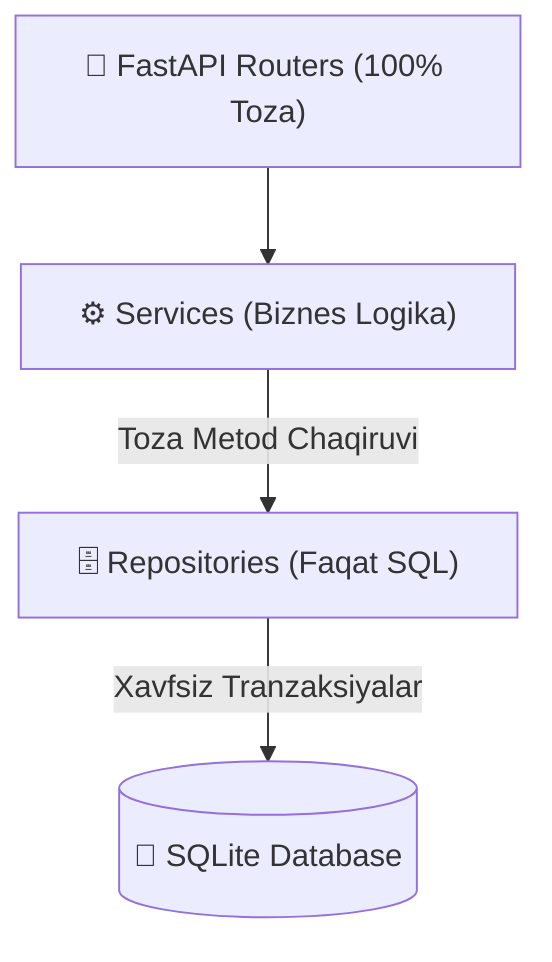

# 🛡️ Servislarni Clean Architecture Talablariga Moslashtirish Rejasi (3 Oylik Mehnatni 100% Saqlagan Holda)

## [Goal Description]
Web routerlar to'liq tozalangach, chuqur tahlil o'tkazilganda ba'zi **Servislar** ichida xom SQL so'rovlar (`conn.execute`) to'g'ridan-to'g'ri yozilganligi aniqlandi. 

**Asosiy maqsad:** 
Loyihaning 3 oydan ortiq yozilgan har bir funksiyasi, biznes qoidasi va logikasiga zarracha zarar yetkazmagan holda, barcha xom SQL so'rovlarni tegishli **Repository** fayllariga ko'chirish va servislar ichida faqat o'sha repozitoriy metodlarini chaqirish.

---

## 🏛️ Arxitektura Sxemasi



---

## User Review Required

> [!IMPORTANT]
> **Hech qanday logika, shart yoki funksionallik o'chirilmaydi yoki o'zgartirilmaydi!**
> Servislar nima ish qilayotgan bo'lsa (xabarnoma yuborish, jonli efirni boshqarish, kesh, token hisoblash), aynan o'sha ishni davom ettiradi. Faqatgina SQL so'rovlar repozitoriyga o'tkaziladi.

> [!NOTE]
> Barcha o'zgarishlar 7 ta aniq va xavfsiz blokda amalga oshiriladi:
> 1. `services/cabinet_service.py` -> `LicenseNodeRepository`
> 2. `services/lesson_completion_service.py` -> `LessonViewRepository`
> 3. `services/course_service.py` -> `AccessGrantRepository`
> 4. `services/ai_tutor_service.py` -> `CabinetRepository`
> 5. `services/server_expense_service.py` -> `ServerExpenseRepository`
> 6. `services/broadcast_service.py` -> `BroadcastRepository`
> 7. `services/live_session_service.py` -> `LiveSessionRepository`

---

## Open Questions

> [!NOTE]
> Ushbu 7 ta servisni routerlardagi kabi bittalab sinab, testlar bilan qadamma-qadam ko'chirib boramizmi? *(Tavsiya: Birin-ketin, har bir servisdan keyin testlarni yurgizib borish kod xavfsizligini 100% kafolatlaydi).*

---

## Proposed Changes

---

### 1. Cabinet Servisi (`services/cabinet_service.py`)

#### Muammo:
`cabinet_service.py` 80-qatorida:
```python
cur = await self._license_node_repo._conn.execute(
    "INSERT INTO license_nodes (parent_id, owner_user_id, course_id, royalty_percent, stage, status) VALUES (1, ?, ?, 20.0, 'limit', 'active')",
    (mentor_user_id, course_id),
)
```

#### [MODIFY] [license_node_repo.py](file:///C:/Users/Acer/Downloads/BilimGo_TOLIQ/BilimGo/db/repositories/license_node_repo.py)
* `create_mentor_license_node(owner_user_id: int, course_id: int = 1, royalty_percent: float = 20.0) -> int` metodi qo'shiladi.

#### [MODIFY] [cabinet_service.py](file:///C:/Users/Acer/Downloads/BilimGo_TOLIQ/BilimGo/services/cabinet_service.py)
* `self._license_node_repo._conn.execute` olib tashlanadi va `await self._license_node_repo.create_mentor_license_node(...)` chaqiriladi.

---

### 2. Lesson Completion Servisi (`services/lesson_completion_service.py`)

#### Muammo:
58-qatorda `self._lesson_view_repo._conn.execute("SELECT id FROM lesson_views WHERE user_id = ? AND lesson_id = ? LIMIT 1")` deb ichki ulanishga murojaat qilingan.

#### [MODIFY] [lesson_view_repo.py](file:///C:/Users/Acer/Downloads/BilimGo_TOLIQ/BilimGo/db/repositories/lesson_view_repo.py)
* `get_view_id_by_user_and_lesson(user_id: int, lesson_id: int) -> int | None` metodi qo'shiladi.

#### [MODIFY] [lesson_completion_service.py](file:///C:/Users/Acer/Downloads/BilimGo_TOLIQ/BilimGo/services/lesson_completion_service.py)
* Xom so'rov repozitoriy chaqiruviga almashtiriladi.

---

### 3. Course Servisi (`services/course_service.py`)

#### Muammo:
* `database.conn.execute("SELECT COUNT(*) as cnt FROM access_grants WHERE course_id = ? AND status = 'active'")`
* `database.conn.execute("SELECT created_at FROM access_grants WHERE user_id = ? AND course_id = ? LIMIT 1")`
* `database.conn.execute("SELECT c.id, c.title, c.owner_node_id, c.base_price... FROM courses c WHERE c.status = 'published'")`

#### [MODIFY] [access_grant_repo.py](file:///C:/Users/Acer/Downloads/BilimGo_TOLIQ/BilimGo/db/repositories/access_grant_repo.py)
* `count_active_students_by_course(course_id: int) -> int`
* `get_grant_created_at(user_id: int, course_id: int) -> str | None`

#### [MODIFY] [course_service.py](file:///C:/Users/Acer/Downloads/BilimGo_TOLIQ/BilimGo/services/course_service.py)
* `database.conn.execute` o'rniga `self._access_grant_repo` va `self._course_repo.list_published()` chaqiriladi.

---

### 4. AI Tutor Servisi (`services/ai_tutor_service.py`)

#### Muammo:
120-qatorda: `SELECT ln.owner_user_id FROM cabinets c JOIN license_nodes ln ON ln.id = c.owner_node_id WHERE c.id = ? LIMIT 1`

#### [MODIFY] [cabinet_repo.py](file:///C:/Users/Acer/Downloads/BilimGo_TOLIQ/BilimGo/db/repositories/cabinet_repo.py)
* `get_owner_user_id_by_cabinet(cabinet_id: int) -> int | None` metodi qo'shiladi.

#### [MODIFY] [ai_tutor_service.py](file:///C:/Users/Acer/Downloads/BilimGo_TOLIQ/BilimGo/services/ai_tutor_service.py)
* To'g'ridan-to'g'ri `database.conn` o'rniga repozitoriy metodi chaqiriladi.

---

### 5. Server Expense Servisi (`services/server_expense_service.py`)

#### Muammo:
24-qatorda: `SELECT ln.owner_user_id AS mentor_id, COUNT(DISTINCT ag.user_id) AS student_count FROM license_nodes ln...`

#### [MODIFY] [server_expense_repo.py](file:///C:/Users/Acer/Downloads/BilimGo_TOLIQ/BilimGo/db/repositories/server_expense_repo.py)
* `get_active_student_counts_per_mentor(year_month: str) -> list[dict]` metodi qo'shiladi.

#### [MODIFY] [server_expense_service.py](file:///C:/Users/Acer/Downloads/BilimGo_TOLIQ/BilimGo/services/server_expense_service.py)
* Xom so'rov repozitoriyga ko'chiriladi.

---

### 6. Broadcast Servisi (`services/broadcast_service.py`)

#### Muammo:
Auditoriyani filtrlash (barcha foydalanuvchilar, mentorlar, kurs talabalari, guruh a'zolari) uchun 7 ta xom SQL so'rovi servis ichida yozilgan.

#### [MODIFY] [broadcast_repo.py](file:///C:/Users/Acer/Downloads/BilimGo_TOLIQ/BilimGo/db/repositories/broadcast_repo.py)
* `get_active_user_telegram_ids() -> list[int]`
* `get_active_mentor_telegram_ids() -> list[int]`
* `get_course_students_telegram_ids(course_id: int, cohort_month: str | None = None) -> list[int]`
* `get_cabinet_students_telegram_ids(cabinet_id: int) -> list[int]`

#### [MODIFY] [broadcast_service.py](file:///C:/Users/Acer/Downloads/BilimGo_TOLIQ/BilimGo/services/broadcast_service.py)
* Barcha xom SQL so'rovlar olib tashlanadi va `BroadcastRepository` ga ulanadi.

---

### 7. Live Session Servisi (`services/live_session_service.py`)

#### Muammo:
Eski efirlarni `ended` qilish, efirlar ro'yxatini olish va kurs qatnashchilarini yig'ish SQL so'rovlari servis ichida bajarilgan.

#### [MODIFY] [live_session_repo.py](file:///C:/Users/Acer/Downloads/BilimGo_TOLIQ/BilimGo/db/repositories/live_session_repo.py)
* `expire_old_sessions(cutoff_hours: int = 3) -> None`
* `list_active_sessions_with_courses(course_id: int | None = None) -> list[dict]`
* `get_course_participant_telegram_ids(course_id: int) -> list[dict]`

#### [MODIFY] [live_session_service.py](file:///C:/Users/Acer/Downloads/BilimGo_TOLIQ/BilimGo/services/live_session_service.py)
* Barcha xom SQL so'rovlar olib tashlanadi.

---

## Verification Plan

### Automated Tests
Har bir servis ko'chirilgach, barcha testlar qayta yurgiziladi:
```powershell
python -c "import sys; sys.path.insert(0, 'BilimGo'); import pytest; sys.exit(pytest.main(['BilimGo/tests']))"
```

Barcha 8 ta mavjud test va yangi servis testlari 100% o'tishi tekshiriladi.
