# 🛠️ BilimGo Loyihasini Bosqichma-Bosqich Tuzatish va Optimallashtirish Rejasi

Ushbu reja 5 ta tahlilchi agent tomonidan aniqlangan kamchilik va xatoliklarni bartaraf etish hamda Clean Architecture tamoyillarini to'liq joriy qilish uchun tuzildi. Foydalanuvchi talabiga asosan ishlar **1-bosqich: Data / DB (Ma'lumotlar bazasi va repozitoriylar)** qatlamidan boshlanadi.

---

## 🎯 Maqsad va Kirish

Loyihani buzib yubormaslik, har bir o'zgarishni xavfsiz va nazorat ostida kiritish uchun ishlar quyidagi 4 ta ketma-ket bosqichga ajratildi:
1. **1-bosqich (DATA)**: Ma'lumotlar bazasi, SQL migratsiyalar yaxlitligi va repozitoriylardagi kritik nuqsonlarni to'g'rilash.
2. **2-bosqich (BOT)**: Telegram botidagi runtime xatoliklar (NameError, unhandled states) va rate-limit muammolarini tuzatish.
3. **3-bosqich (SERVICES)**: Biznes mantiq qatlamidagi uzilishlar (Adaptive Unlock, Nudge matnlari, create_default factory) ni to'g'rilash.
4. **4-bosqich (WEB & SECURITY)**: Web API routerlari (Fat Controller muammosi), WebSocket xavfsizligi va CORS sozlamalarini xavfsiz holatga keltirish.

---

## ⚠️ Foydalanuvchi Ko'rigi Talab Qilinadigan Masalalar (User Review Required)

> [!IMPORTANT]
> **1-bosqich (Data qatlami) bo'yicha muhim eslatma:**
> Mavjud `bilimgo.db` faylida `courses.is_waitlist` ustuni mavjud bo'lsa-da, u migratsiyalar (`0001`–`0025`) fayllarida yo'q. Dastur yangi server yoki Docker konteynerida ishga tushganda bazada bu ustun yaratilmay qoladi va tizim qulaydi. Shu sababli yangi xavfsiz `0026_add_is_waitlist_to_courses.sql` migratsiyasi kiritiladi.

---

## ❓ Ochiq Savollar (Open Questions)

> [!NOTE]
> Barcha o'zgarishlar mavjud ma'lumotlarni o'chirmasdan, faqat nuqsonlarni bartaraf etish tarzida tuzildi. Hozircha qo'shimcha ochiq savollar yo'q, 1-bosqich tasdiqlangach bevosita DB qatlamidan boshlaymiz.

---

## 📋 Rejalashtirilgan O'zgarishlar (Proposed Changes)

```mermaid
flowchart LR
    subgraph Step1["1-Bosqich: Data Qatlami"]
        M26["0026 Migratsiya: courses.is_waitlist"]
        Repo1["license_node_repo.py: commit qo'shish"]
        Repo2["broadcast_repo.py: DDL tozalash"]
        Repo3["lesson_view_repo.py: SQL parametri"]
    end
    
    subgraph Step2["2-Bosqich: Bot Qatlami"]
        Bot1["student/catalog.py: count NameError"]
        Bot2["admin/broadcast.py: Shadowed handlerlar"]
        Bot3["mentor/live.py: FloodWait himoyasi"]
    end
    
    subgraph Step3["3-Bosqich: Servislar"]
        Svc1["access_control: adaptive_unlock bog'lash"]
        Svc2["engagement_monitor: {name} formati"]
        Svc3["Servislarga create_default factory"]
    end
    
    subgraph Step4["4-Bosqich: Web & Xavfsizlik"]
        Web1["live_websocket.py: Auth himoyasi"]
        Web2["player.py: Fat Controller refaktoring"]
        Web3["web/main.py: CORS to'g'rilash"]
    end

    Step1 --> Step2 --> Step3 --> Step4
```



---

### 1-Bosqich: Ma'lumotlar Bazasi va Repozitoriylar (Data Qatlami) — BIRINCHI BOSQICH

Ushbu bosqichda ma'lumotlar bazasi konsistentligi va repozitoriylardagi xatoliklar bartaraf etiladi:

#### [NEW] `BilimGo/db/migrations/0026_add_is_waitlist_to_courses.sql`
- Yangi server yoki test muhitlarida `courses` jadvaliga `is_waitlist` ustunini xavfsiz qo'shish:
```sql
-- 0026_add_is_waitlist_to_courses.sql
-- courses jadvaliga is_waitlist ustunini qo'shish (mavjud bo'lmasa)
ALTER TABLE courses ADD COLUMN is_waitlist INTEGER NOT NULL DEFAULT 0;
```
*(Eslatma: `database.py` migratsiyani bajarishdan oldin ustun allaqachon mavjudligini tekshiruvchi yoki `sqlite3.OperationalError: duplicate column name` ni xavfsiz chetlab o'tuvchi mantiq bilan ta'minlanadi).*

#### [MODIFY] `BilimGo/db/repositories/license_node_repo.py`
- `update_course_id` metodiga unutilgan `await self._conn.commit()` ni qo'shish:
```python
    async def update_course_id(self, node_id: int, course_id: int) -> None:
        await self._conn.execute(
            "UPDATE license_nodes SET course_id = ? WHERE id = ?",
            (course_id, node_id),
        )
        await self._conn.commit()
```

#### [MODIFY] `BilimGo/db/repositories/broadcast_repo.py`
- `create_broadcast` metodi ichidagi runtime DDL (`CREATE TABLE IF NOT EXISTS broadcasts ...`) ni olib tashlash va uning tuzilishini rasmiy migratsiya bilan muvofiqlashtirish.

#### [MODIFY] `BilimGo/db/repositories/lesson_view_repo.py`
- `get_daily_activity_map` metodidagi f-string orqali qo'yilgan `days` parametrini xavfsiz SQLite parametrli so'roviga aylantirish:
```python
# Eski: f"WHERE user_id = ? AND started_at >= datetime('now', '-{days} days')"
# Yangi:
cursor = await self._conn.execute(
    "SELECT date(started_at) as day, COUNT(*) as cnt "
    "FROM lesson_views "
    "WHERE user_id = ? AND started_at >= datetime('now', '-' || ? || ' days') "
    "GROUP BY date(started_at)",
    (user_id, days),
)
```

---

### 2-Bosqich: Telegram Bot Qatlami (Bot Layer)

#### [MODIFY] `BilimGo/bot/handlers/student/catalog.py`
- 174–204-qatorlardagi `handle_waitlist_leave` callbackida aniqlanmagan `count` o'zgaruvchisini to'g'rilash:
```python
    res = await course_service.leave_waitlist(course_id, callback.from_user.id)
    course_title = res.get("course_title", "Kurs")
    count = res.get("waitlist_count", 0)
```

#### [MODIFY] `BilimGo/bot/handlers/admin/broadcast.py`
- `admin/statistics.py` tomonidan berkitib qo'yilgan va hech qachon ishlamaydigan `Command("admin")` va `F.text.in_(...)` dublikat handlerlarini olib tashlash.

#### [MODIFY] `BilimGo/bot/handlers/mentor/live.py`
- Jonli dars xabarnomasini talabalarga yuborishda FloodWait xavfini bartaraf etish uchun `asyncio.sleep(0.05)` va xatoliklarni xavfsiz qayta ishlashni qo'shish.

---

### 3-Bosqich: Biznes Servislar Qatlami (Services Layer)

#### [MODIFY] `BilimGo/services/access_control_service.py`
- `AdaptiveUnlockService` ni `ensure_can_watch` tekshiruviga ulash: talaba dars ko'rmoqchi bo'lganda, uning kunlik adaptiv ochilgan darslar tartib raqamidan oshib ketmaganligini tekshirish.

#### [MODIFY] `BilimGo/services/engagement_monitor_service.py`
- `NUDGE_STEPS` dagi `{name}` format xatosini to'g'rilash: agar ism mavjud bo'lsa `.format(name=...)`, aks holda standart murojaat bilan xavfsiz almashtirish.

---

### 4-Bosqich: Web API va Xavfsizlik (Web & Security Layer)

#### [MODIFY] `BilimGo/web/routers/live_websocket.py`
- Ochiq query parametr (`?user_id=...`) o'rniga xavfsiz Telegram WebApp HMAC SHA-256 yoki token tekshiruvini joriy etish.

#### [MODIFY] `BilimGo/web/main.py`
- CORS `allow_origins=["*"]` bilan `allow_credentials=True` xavfsizlik to'qnashuvini to'g'rilash.

---

## 🧪 Sinov va Tekshirish Rejasi (Verification Plan)

### Avtomatlashtirilgan Testlar
1. **DB Migratsiyalari va Repozitoriylar Tekshiruvi:**
   - Yangi migratsiyani qo'llash va `database.py` ning `run_migrations` funksiyasini sinash.
   - `access_grant_repo.py:get_student_courses_with_progress` metodi hech qanday xatoliksiz ishlashini skript orqali tekshirish:
     ```powershell
     python -c "import asyncio; from db.database import database; from db.repositories.access_grant_repo import AccessGrantRepository; asyncio.run(database.connect()); repo = AccessGrantRepository(database.conn); print(asyncio.run(repo.get_student_courses_with_progress(1))); asyncio.run(database.close())"
     ```
2. **Bot Handlerlari Tekshiruvi:**
   - `python -m py_compile BilimGo/bot/handlers/student/catalog.py` orqali sintaktik xatolik yo'qligini tekshirish.
3. **Mavjud Testlarni Ishga Tushirish:**
   - Loyihadagi `BilimGo/tests/` testlarini yurgizish:
     ```powershell
     pytest BilimGo/tests
     ```

### Qo'lda Tekshirish (Manual Verification)
1. Telegram botda `/start` va kurslar katalogi (Waitlist ga kirish va chiqish) xatoliksiz ishlashini ko'rish.
2. WebApp player va kabinet interfeysida kurslar ro'yxati va dars progressi to'g'ri ko'rinishini tekshirish.
